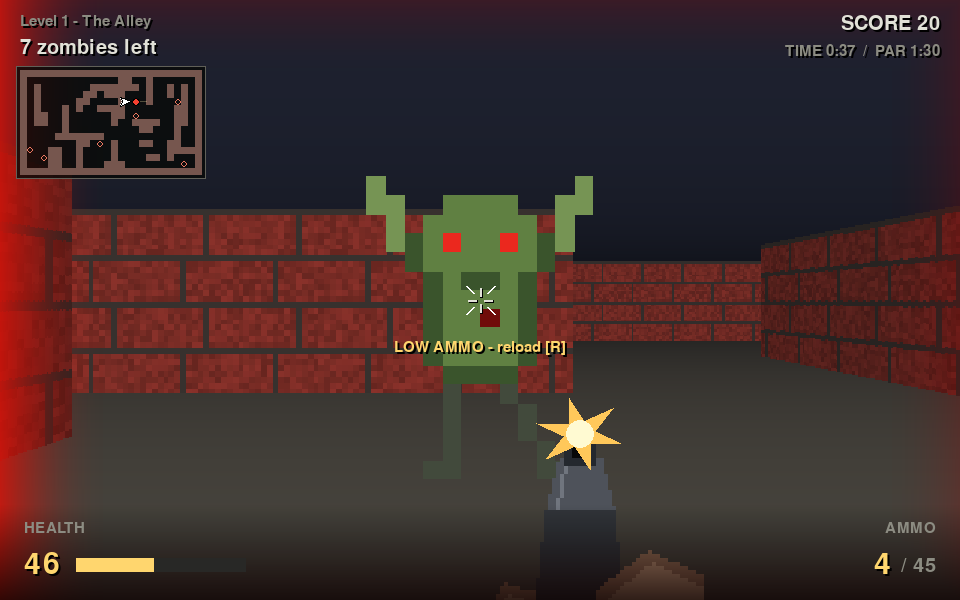
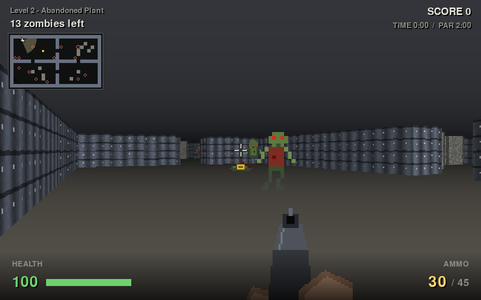
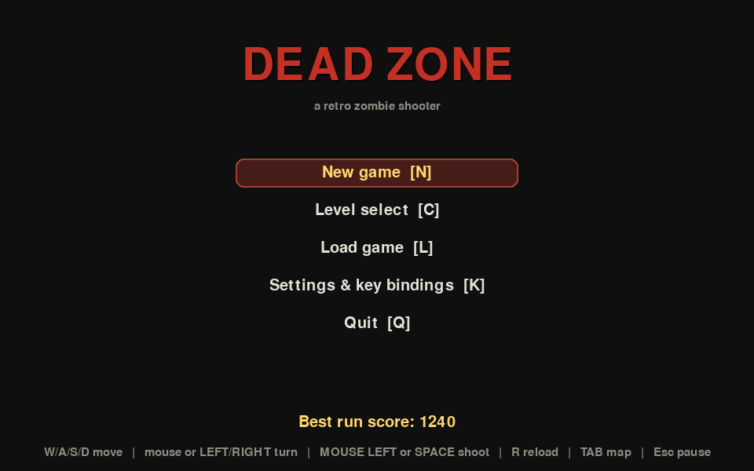
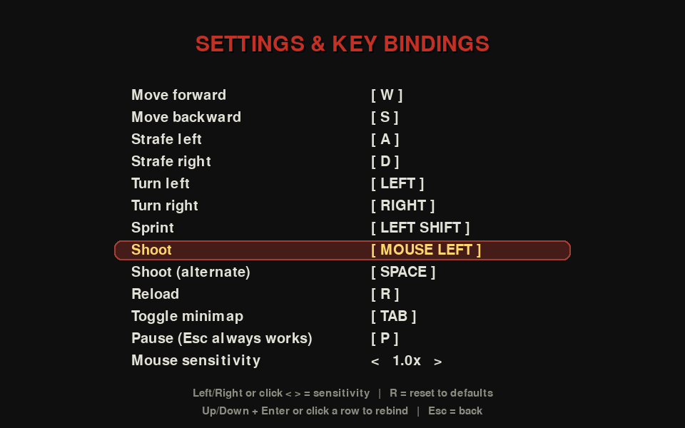
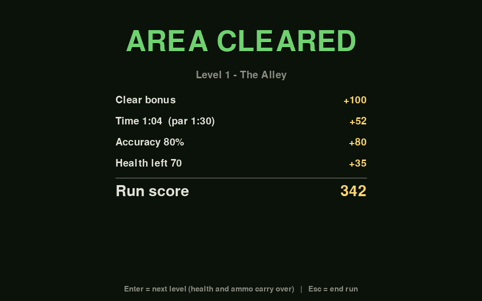
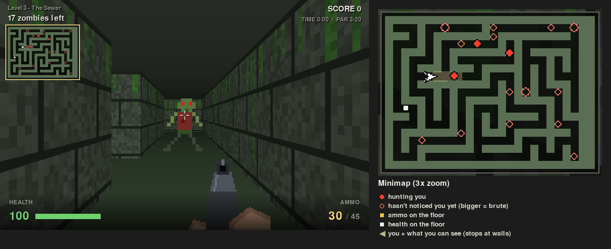

# Dead Zone

A lightweight first-person zombie shooter in the spirit of Wolfenstein 3D:
DDA raycasting, a three-level campaign, zombies that hunt you through the
maze, a minimap, three-slot save/load, and fully customizable key and mouse
bindings.

Written in Python + pygame. **pygame is the only dependency** — every texture,
sprite, and sound effect is generated procedurally at startup (zero asset
files).



## Screenshots

| | |
|---|---|
|  |  |
| **Abandoned Plant** - a runner closes in; the corpse left an ammo drop | **Main menu** |
|  |  |
| **Settings** - every action rebindable, including to mouse buttons | **Level cleared** - clear, time, accuracy and health bonuses |

**The minimap** (top left, Tab shows/hides it) in the Sewer, with an enlarged
copy and its legend:



## Requirements

- Python 3.10+ (tested on 3.11)
- pygame 2.x, pinned in `requirements.txt` (official Windows wheels:
  `pip install -r requirements.txt`)

Windows 11 works out of the box — no compiler, no assets, no extra libraries.

## Run

```bash
git clone https://github.com/zhuanyi/dead-zone.git
cd dead-zone
```

```bash
# Linux / macOS
python -m venv .venv
source .venv/bin/activate
pip install -r requirements.txt
python main.py
```

```bat
:: Windows 11
python -m venv .venv
.venv\Scripts\activate
pip install -r requirements.txt
python main.py
```

Optional headless smoke test (no window):

```bash
python main.py --smoke
```

Unit tests:

```bash
python -m unittest tests.test_game -v
```

## Controls (defaults — all can be rebound, including to mouse buttons)

| Action          | Default            |
|-----------------|--------------------|
| Forward / Back  | W / S              |
| Strafe          | A / D              |
| Turn            | mouse (or ← / →)   |
| Sprint          | Left Shift         |
| Shoot           | Left mouse button  |
| Shoot (alt)     | Space              |
| Reload          | R                  |
| Minimap         | Tab (show / hide)  |
| Pause           | P — **Esc always pauses too** |

The mouse turns the camera while playing (cursor is captured). Open
**Settings & key bindings** from the main or pause menu: pick a row with the
arrows + Enter (or click it), then press the new key or mouse button. Binding
a key that is already used swaps the two actions. Left/Right adjusts mouse
sensitivity; `R` resets everything (and shows the minimap again). Esc can't
be rebound, so you can never lock yourself out of the pause menu. Settings,
including whether the minimap is shown, persist in `~/.deadzone/keys.json`.

Nothing quits on a single key press mid-game: leave a run from the pause
menu (with a confirmation). Losing window focus pauses the game.

## Game

- **Campaign:** New Game plays The Alley → Abandoned Plant → The Sewer.
  Health, ammo and score carry over (between levels you patch up to at least
  50 HP and scavenge up to 60 rounds). Levels unlock in Level Select as you
  clear them. Dying lets you retry the level with the stats you entered it
  with.
- **Zombies** idle until they notice you — line of sight, getting close, or
  hearing a **gunshot** (it carries ~11 tiles of walking distance, so firing
  draws a crowd). Once hunting, they path-find through the level. When three
  or fewer are left, they all come for you.
  - **Walkers** (steady), **runners** (as fast as you walk — sprint to escape),
    **brutes** (slow, tough, heavy hits, always drop a pickup).
  - Attacks are **telegraphed**: a zombie raises its arms before the blow
    lands. Back off in time and it misses. You can't walk through zombies.
  - Groans, growls and swipes are positioned in stereo — listen for what's
    behind you.
- **Minimap** (top left, Tab shows/hides it): the whole level, north up.
  You are the white arrow; the pale cone is what you can see (it stops at
  walls). Every zombie still standing is marked - a **filled red dot** is
  hunting you, a **hollow ring** hasn't noticed you yet, and brutes are
  bigger. Drops on the floor show as **yellow** (ammo) and **white**
  (health) squares. The map is oriented like the view: facing up the map,
  what's on your right on screen is right of the arrow.
- **Shooting** is hitscan along the crosshair: you hit what's under it
  (within the zombie's body), nearest first. 30-round magazine, 45 in reserve
  to start, 1 s reload.
- **Drops:** kills sometimes drop ammo (+10 reserve) or health (+25, left on
  the floor if you're at full health). If you're nearly out of ammo, kills
  always drop ammo.
- **Score:** kill points plus a clear bonus per level — base, time under par,
  accuracy, and remaining health. The best run score is kept in
  `~/.deadzone/best.json` (with campaign progress).
- **Pause** menu: save, load, settings, quit to menu / desktop.
- **Saves:** three slots (small JSON files) storing the full level state.
  Saves from earlier versions still load.

All data lives in `~/.deadzone/` (override with the `DEADZONE_HOME` env var).

## Layout

```
docs/screenshots/   the images in this README
main.py             entry point (windowed or --smoke)
game/levels.py      3 hand-made maps, themes, zombie stats
game/world.py       grid collision, line of sight, BFS flow field (pathfinding)
game/game.py        one level in play: simulation + rules (noise, drops, scoring, carry-over)
game/player.py      movement, body-blocking, hitscan shooting, reload, pickups
game/zombies.py     idle/chase AI, path following, telegraphed attacks, death
game/raycaster.py   DDA raycaster, fog, floor/ceiling backdrop, billboards
game/minimap.py     corner minimap: level, player + view cone, zombies, drops
game/sprites.py     procedural pixel-art zombies (walk/attack/corpse frames)
game/textures.py    procedural wall textures + fog tinting
game/sound.py       synthesized SFX with stereo positioning
game/keys.py        key + mouse bindings, sensitivity
game/save.py        3-slot JSON save/load (validated, migrates old saves)
game/ui.py          menus, dialogs, HUD, first-person gun
game/engine.py      screen state machine + main loop
game/smoke.py       headless smoke test
tests/test_game.py  85 unit tests (levels, AI, shooting, rules, keys, saves, render,
                    minimap, screen flow)
```
